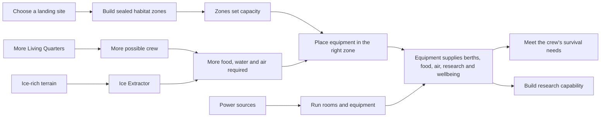

# Habitat systems: from empty shells to a working Mars base

The goal is to safely support the mission crew and build research capability. A habitat is not ready merely because its rooms have been placed: rooms create **capacity**, and equipment supplies the things the crew actually uses.

## The key rule

> **Zones make room. Equipment makes the room useful.**

For example, Hydroponics without grow trays produces no food; Living Quarters without bunks house no crew.

## What each part provides

| Build or place | It creates / supplies | It depends on |
|---|---|---|
| Living Quarters zone | Maximum number of crew that can be accommodated | Crew Bunks to provide actual berths; power for inhabited rooms |
| Crew Bunk | One usable berth and a small wellbeing benefit | Space in Living Quarters; power |
| Locker / Common Table / Task Light | Storage and crew wellbeing | A suitable interior room; task lights need power |
| Hydroponics zone | Maximum food-growing capacity | Grow Trays to produce food; power and water |
| Grow Tray | Food, plus a small wellbeing benefit | Hydroponics or Glass Greenhouse capacity; water and power |
| Life Support zone | Maximum air-and-water-support capacity | Air Recyclers to provide life support; power |
| Air Recycler | Breathable-air and recycling support | Life Support capacity and power |
| Science Lab zone | Maximum research capacity | Science Workbenches to generate research; power |
| Science Workbench | Research capability | Science Lab capacity and power |
| Ice Extractor | Water from buried ice | An ice-rich map cell and enough power |
| Solar Array / Compact Reactor | Electricity for the habitat | Habitat inside its power field |

## How the crew target changes

The first mission requires support for **six crew**. Expanding Living Quarters beyond that increases the crew capacity the player has chosen to build for. That larger capacity raises the required amount of:

- crew berths;
- food production;
- water supply; and
- life support (oxygen and recycling).

This rewards compact, efficient early habitats while giving players a meaningful decision when they choose to expand: more room is not automatically better unless they can power and furnish it.

## Example planning loop

1. Build enough Living Quarters to make room for six crew.
2. Add six Crew Bunks. The room capacity now becomes usable berths.
3. Build Hydroponics and add Grow Trays until their food output reaches the crew requirement.
4. Build Life Support and add Air Recyclers to match the same crew requirement.
5. Survey the blue ice heatmap, place an Ice Extractor where ice is recoverable, and provide enough water.
6. Build Solar Arrays or a Compact Reactor so generation covers the combined rooms and equipment load.
7. Add a Science Lab and Workbenches to meet the research goal; personalise the habitat with wellbeing equipment once it is safe.

## Player-facing status language

The HUD reports both sides of a requirement. For example:

`3 / 6 equipped · room for 6`

This means the player made sufficient room, but has only installed three of the six required pieces of equipment.
